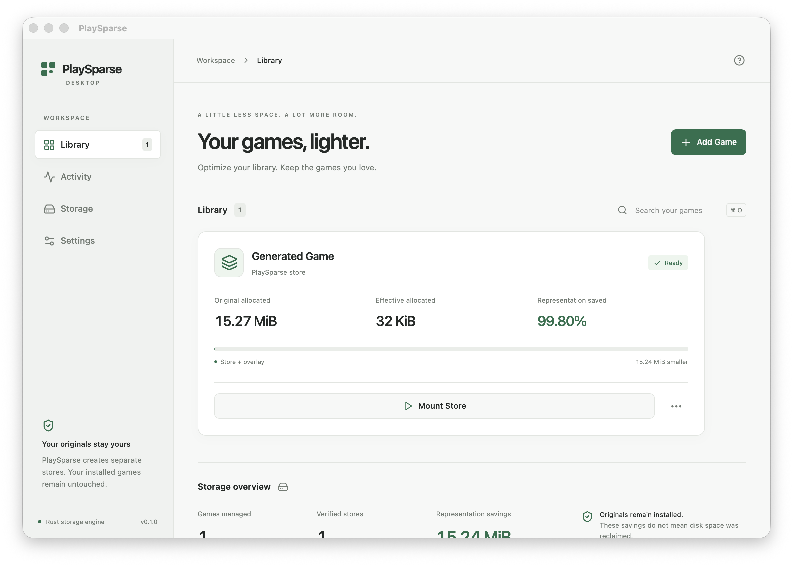
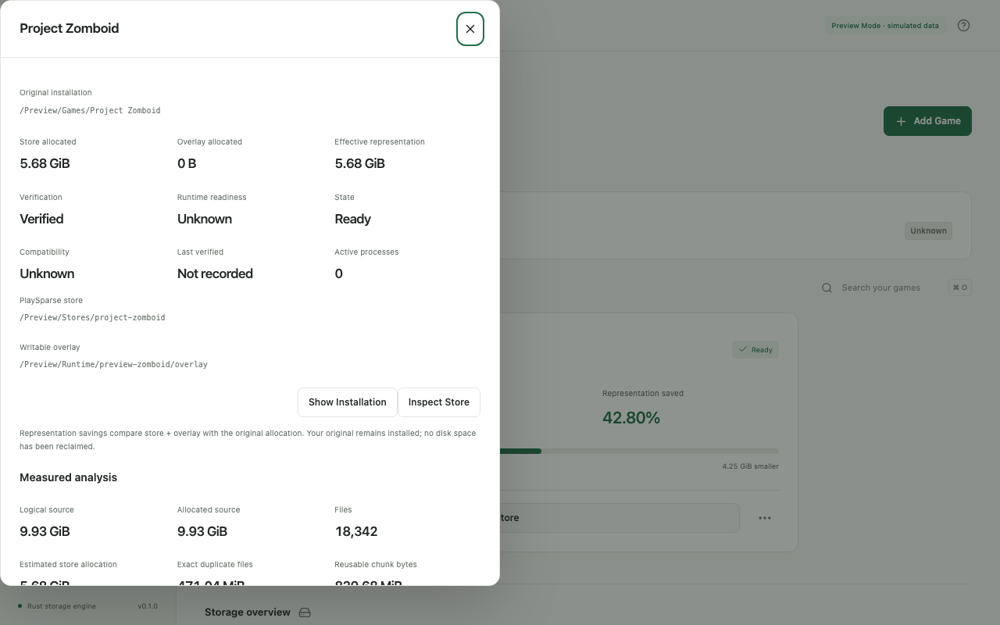

<h1 align="center">PlaySparse</h1>

<strong>Store differently. Keep reading ordinary files.</strong>

  
  
  

> **Showcase, not source distribution.** This folder contains selected UI captures and a product overview, **not** PlaySparse's engine, desktop source, installer or an available commercial license. Existing MIT licenses for previously published source versions remain in effect.

## Adaptive virtual storage for large game installations

PlaySparse experiments with content-addressed, chunked, compressed and verified storage served back to applications as ordinary filesystem content. It explores whether data representation, caching and mount behavior can be optimized without modifying the original game files.

### What has actually been implemented

- Rust storage/runtime research with measured file analysis, verified stores, range reads and source-preserving packing.
- A **Tauri / React desktop application** with library, folder selection, analysis, diagnostics and job controls.
- Mount integration through platform-specific drivers and guarded runtime sessions.
- Demonstration paths on Apple Silicon macOS and targeted Windows workloads with separate recorded validation scopes.

### Important caveats

- **No promise of 10×–15× lossless compression**, especially for already-compressed game assets.
- Original installation data stays on disk; representation savings are **not automatically reclaimed free disk space**.
- Driver compatibility, anti-cheat, launchers and commercial game behavior differ by platform and workload.
- The current app builds are **development artifacts**, not signed/notarized consumer releases.
- Individual game/hardware examples do not establish universal compatibility.

[Original screenshot provenance and MIT notice](ASSET_PROVENANCE.md).

Screenshots are documented UI captures from the original project. The native image uses generated fixtures; some desktop preview images explicitly represent preview-mode data. This showcase does not manufacture performance results.

## Engineering and partnerships

I can discuss tailored Rust/Tauri prototypes, storage benchmarking, feasibility tests and driver/runtime integration.

[Email for a scoped project discussion](mailto:scubi.dubi.do2410@gmail.com?subject=PlaySparse%20research%20and%20implementation). Please include the target platform, workload description, acceptance criteria and timeframe, but **no confidential assets, license keys or proprietary files** in the initial message.

Any project scope, IP assignment, price or maintenance commitment would require a separate agreement. This showcase does not alter prior MIT licensing terms.
