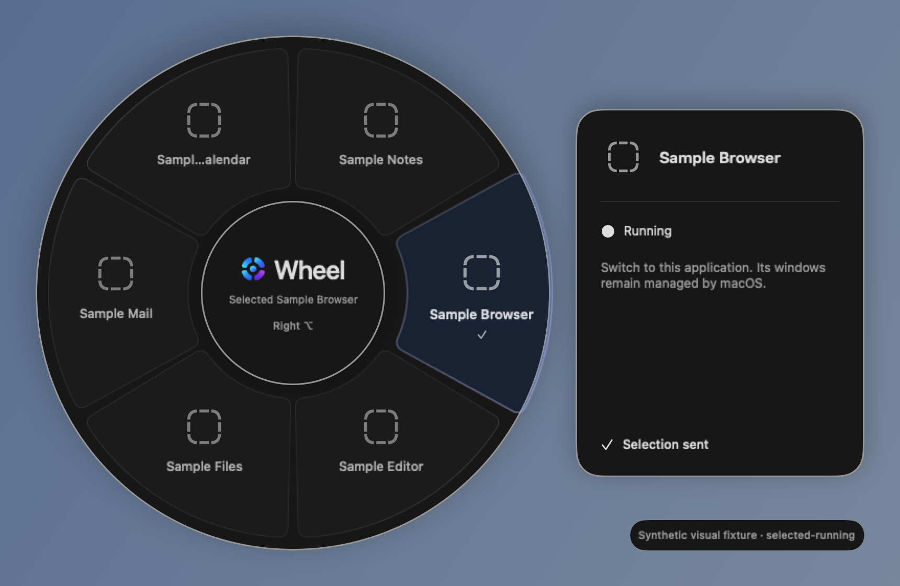
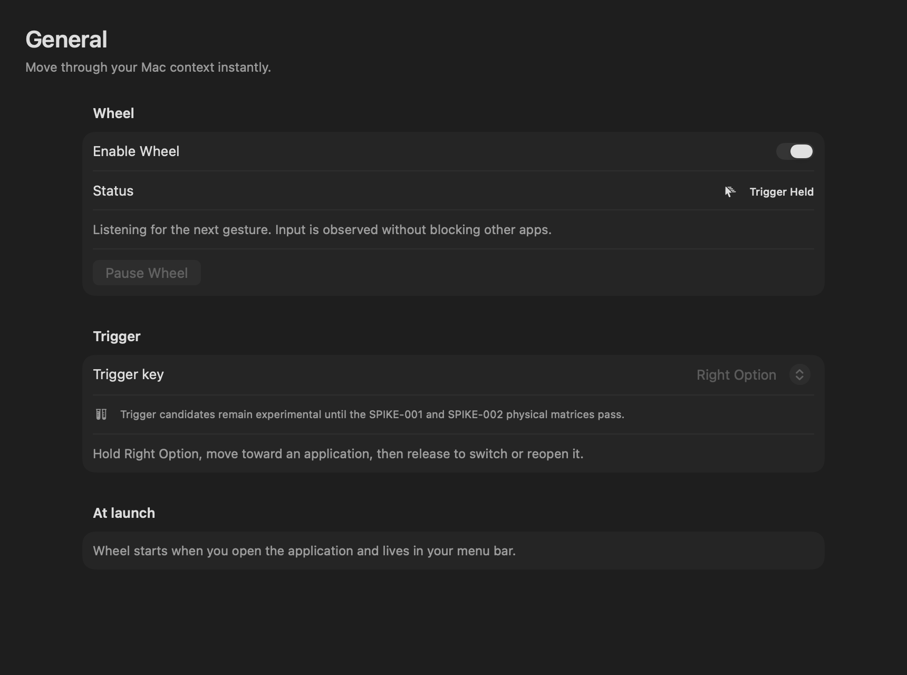

<h1 align="center">Wheel</h1>

<strong>Move through your Mac context, spatially.</strong>

  
  
  

> **Showcase, not source distribution.** This folder contains screenshots and product information, **not** Wheel's application source or a public installation package. It is not a production release. The prior MIT-licensed code of the original public Wheel repository remains available under the license terms under which it was published.

## Navigate by direction, not by hunting for a window

Wheel is an experimental, native macOS utility: hold the configured trigger, move the pointer toward an application in the radial overlay, then release to switch to it. Pinned sectors and recent application history make repeated navigation faster.

### Current implemented capabilities

- **Radial navigation** between tracked applications and recently closed app destinations.
- **Pinned sectors** and a flexible **2–12 direction** layout.
- **App-level restoration:** activate running applications or relaunch remembered closed applications when history is enabled.
- **Local-first app history** built with SwiftUI/AppKit and native macOS presentation.
- **Accessibility-aware settings** including reduced motion/transparency and contrast preferences.

### What Wheel does *not* currently do

Wheel does **not** reliably restore an exact application window, browser tab, Finder folder, IDE file, scroll position or unsaved state. The current app is at **application-level navigation**, not complete workspace/session restoration. Input trigger and permissions require physical macOS validation; screenshots alone are not that proof.

[Original screenshot provenance and MIT notice](ASSET_PROVENANCE.md).

### Screenshot provenance

These images were rendered from the **packaged Wheel.app production UI** against isolated **synthetic fixture data**, not captured from somebody's desktop or confidential documents. Appearance depends on macOS version and accessibility settings.

## Project work / implementation

Interested in a custom navigation workflow or macOS utility? [Email to discuss your use case](mailto:scubi.dubi.do2410@gmail.com?subject=Wheel%20custom%20macOS%20implementation), including target macOS version, use case, desired integration and an approximate timeline.

Availability, ownership of newly commissioned work, budget and support would be agreed separately. No paid download, release date or guaranteed system integration is implied.

**About licensing:** Keeping new work private does not invalidate existing MIT grants for old public versions. All bundled third-party components remain subject to their respective licenses.
